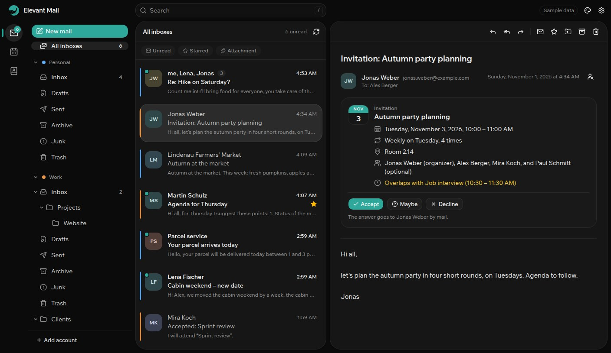
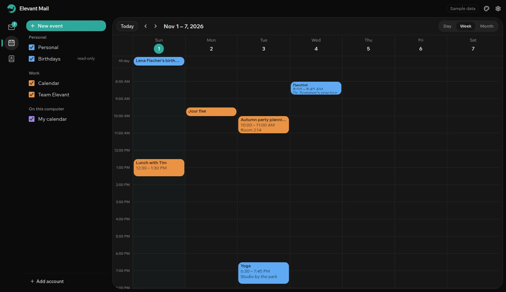
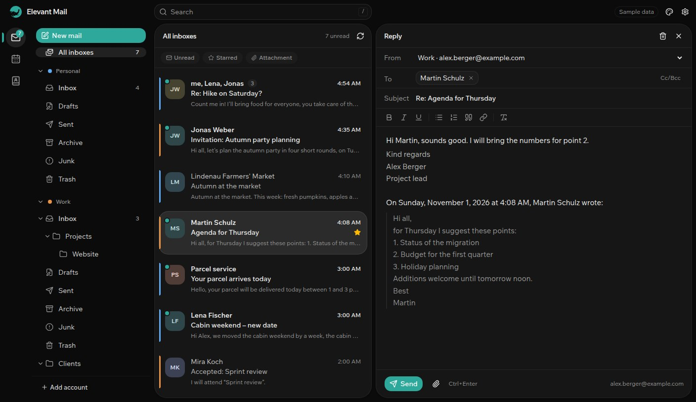
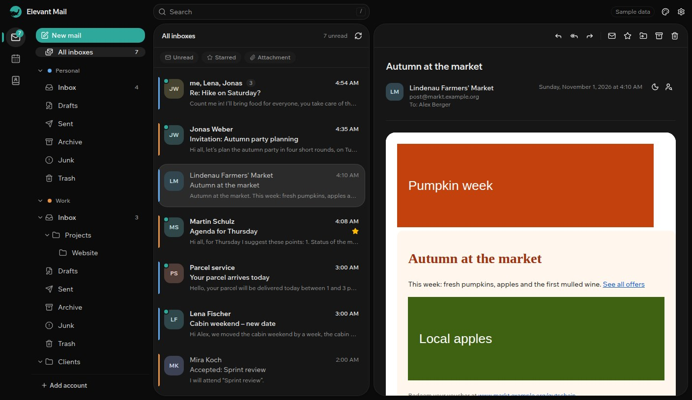
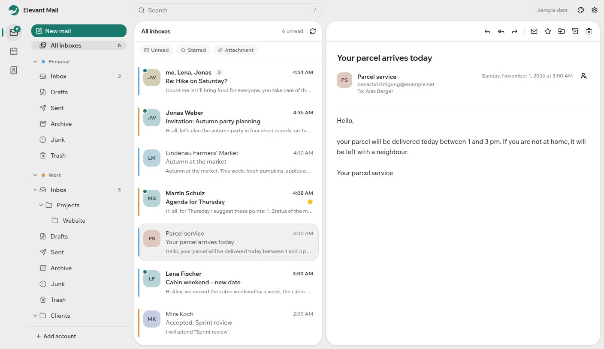

# Elevant Mail

[](https://github.com/Elevant-Development/elevant-mail/actions/workflows/ci.yml)
[](LICENSE)

A fast, private mail client for Linux and Windows. All your IMAP accounts in one window, with a
unified inbox and a calm interface, for reading and writing mail, with your calendars and
contacts beside it.

- **Free and open source.** No paywall, no subscription, no account with us.
- **Private.** No cloud, no telemetry. The app talks to your mail servers and nothing else.
- **Local first.** Your mail is cached on your computer, opens instantly and stays readable
  offline.



> **Status: v0.6, mail, calendar and contacts.** Elevant Mail reads, searches, organizes and
> writes mail for several accounts, and keeps your calendars and address books in step over
> CalDAV, CardDAV and Microsoft 365. It is early software: please keep another mail client around
> for now, and
> [tell us](https://github.com/Elevant-Development/elevant-mail/issues) what breaks.

## Features

- **Several accounts** with a unified inbox (you choose which accounts it brings together), a
  color per account and a collapsible folder tree
- **Works with** self-hosted mail servers, Gmail, Microsoft 365, Outlook.com, web.de, GMX and any
  other IMAP provider. Server settings are suggested from your address.
- **Sign in with Microsoft** for Microsoft 365 and Outlook.com, no password stored
- **Writing:** new mail, reply, reply all and forward right next to the list, with bold, italic,
  lists, quotes and links. Recipients come with suggestions from your mail; replies stay in
  their conversation.
- **Drafts** are saved as you type and kept in your account's drafts folder, so you can finish
  them later or on your phone
- **Attachments** with the paperclip or by dragging files onto the mail; forwarding takes the
  original's files along
- **Signatures** per account, written in the app or pasted as HTML with logo and table
- **New mail right away** (IMAP IDLE) with a desktop notification, with or without sender and
  subject
- **Conversations:** replies sit with the mail they answer, your own replies from Sent included.
  Prefer single messages? Switch it off in the appearance.
- **Archive, delete and move** one mail or many at once, with ten seconds to undo
- **Fast search** across all accounts and folders, right on your computer, with filters like
  `from:lena` or `is:unread` (see [Searching](#searching)). On request it also searches your mail
  servers, for older mail.
- **Filter bar** for unread, starred and mail with attachments
- **You choose how much stays offline:** per account the last month, three months, a year or
  everything. Folders with tens of thousands of mails still scroll smoothly.
- **Safe HTML mail:** scripts never run, external images stay blocked until you allow them for
  one mail or always for a sender, links open in your browser and the app warns when a link leads
  somewhere other than it shows
- **Attachments:** open or save them. Files that could run programs are only saved, never opened
  directly.
- **Read and starred** state syncs back to the server
- **Calendar** with day, week and month view: create, change and delete events, all-day and
  repeating ones too, with reminders and a color per calendar. Your calendars stay in step both
  ways over CalDAV (Mailcow/SOGo, Nextcloud, Posteo, mailbox.org, iCloud and others) and with
  Microsoft 365 and Outlook.com.
- **Invitations** show in the mail with what else is on at that time; accept, maybe or decline
  in one click, and accepted events land in your calendar
- **Contacts** from your address books (CardDAV, Microsoft 365, Outlook.com), searchable, editable
  and offered first when you write a recipient
- **Keeps running in the tray** after you close the window, so new mail and reminders still
  arrive; it can also start at login
- **For AI agents (MCP):** tools like Claude Code can search and read the accounts you share with
  them, and only do more (mark, move, trash, write drafts) where you allow it. Off until you
  switch it on; see [AI agents](#ai-agents-mcp).
- **Drag mail onto folders,** right-click a mail for its actions, and drag the columns to the
  width you like
- **Move your accounts** to another computer with an export file, passwords only when you
  choose, encrypted with a passphrase
- **Keyboard control** for the whole mail view (see [Keyboard shortcuts](#keyboard-shortcuts))
- **Dark and light mode,** six accent colors, two densities, several bundled fonts
- **Readable newsletters in dark mode:** designed mail sits on a light page, simple mail follows
  the dark theme, and you can switch per mail
- **English and German.** The app follows your system language; more languages are welcome.





| Designed newsletter with images allowed        | Light mode with attachments               |
| ---------------------------------------------- | ----------------------------------------- |
|  |  |

## Download and install

Get the latest version from the
[releases page](https://github.com/Elevant-Development/elevant-mail/releases/latest).

### Linux

**Ubuntu, Debian, Linux Mint and other Debian-based systems:** download the `.deb` file and
install it:

```bash
sudo apt install ./Elevant.Mail_*_amd64.deb
```

Elevant Mail then appears in your app menu. To remove it later: `sudo apt remove elevant-mail`.

**Other distributions:** use the `.AppImage`. Make it executable and start it:

```bash
chmod +x Elevant.Mail_*_amd64.AppImage
./Elevant.Mail_*_amd64.AppImage
```

If the AppImage does not start, your system lacks FUSE: install it with your package manager
(`fuse3` on most distributions).

Passwords are stored in the system keyring through the Secret Service. GNOME provides it out of
the box; on KDE, KWallet does it once its Secret Service interface is enabled.

### Windows

Windows 10 and 11, 64-bit. Download the `…_x64-setup.exe` file and run it.

The installer is not code-signed yet, so Windows SmartScreen may warn that it does not know the
app. Click **More info**, then **Run anyway**. Passwords go into the Windows Credential Manager.

### Updates

Once a day Elevant Mail asks GitHub whether a newer version was released and then shows it at
the top, next to the settings, with a link to the download page. It does not download or install
anything by itself. Install a new version over the old one; your accounts and mail stay. The
first start explains the check; switch it off under **Settings → Notifications**.

## Getting started

Click **Add account**, enter your email address and password, and Elevant Mail suggests the
server settings. It signs in once to check them before saving the account. For some providers
there is one extra step:

| Provider                    | What you need                                                                                                                                                                                    |
| --------------------------- | ------------------------------------------------------------------------------------------------------------------------------------------------------------------------------------------------ |
| Gmail                       | An **app password** instead of your normal password: Google Account → Security → App passwords (needs 2-Step Verification). Gmail labels appear as folders.                                      |
| Microsoft 365               | Click **Sign in with Microsoft.** Your browser opens the Microsoft sign-in; no password is entered in the app. Some organizations require an admin to allow Elevant Mail once (see [FAQ](#faq)). |
| Outlook.com, Hotmail        | **Sign in with Microsoft**, as above.                                                                                                                                                            |
| web.de, GMX                 | Switch on IMAP in the web mail settings first: Settings → POP3/IMAP access.                                                                                                                      |
| iCloud                      | An **app-specific password** from account.apple.com.                                                                                                                                             |
| Yahoo                       | An **app password** from your account's security settings.                                                                                                                                       |
| Your own server (Mailcow …) | Usually nothing: the settings come from your domain's mail server. Check them if the app says they were guessed.                                                                                 |

The app shows these hints in the dialog as soon as it recognizes your provider, and every error
comes with a concrete next step.

The interface language follows your system. To change it, open **Appearance** (the palette icon
at the top right) and pick a language; the same menu has mode, colors, density and font.

**Settings** (the gear icon at the top right) has the rest: per account its name, color, server
settings, password, how far back mail stays on your computer and, under **Sending**, the name
your mail goes out under, the signature and the outgoing server (suggested from the incoming
one); notifications; and under
**Reading** which accounts the unified inbox brings together, which inbox opens at start, when an
opened mail counts as read and whose images always load.

## AI agents (MCP)

Elevant Mail can let AI agents such as Claude Code work with your mail over the
[Model Context Protocol](https://modelcontextprotocol.io). The agent starts the app's program as
its server (`elevant-mail mcp`); it reads the mail on your computer, gets no passwords and needs
no network. The app does not have to be open, but changes an agent makes reach your mail server
only while it runs.

1. Open **Settings → AI agents** and switch on **Access for AI agents**.
2. Per account, switch on **Read** and, if you like, what else agents may do: **Mark**, **Move,
   archive**, **Move to trash**, **Write drafts**. Agents never send mail and never delete it for
   good; drafts wait in your drafts folder for you to send.
3. Copy the command shown there into a terminal, for Claude Code for example
   `claude mcp add elevant-mail -- /path/to/elevant-mail mcp`. Other MCP clients get the same as
   JSON.

The page logs every access, refused ones too. Mail is written by strangers, so every result tells
the agent that its content is data, not instructions; still, give agents only the rights you
need.

## Searching

Type into the search field at the top; every word has to match, as a word or the start of one
("invoi" finds "invoice"). Filters narrow it down and work on their own, too:

| Filter                            | Finds                                  |
| --------------------------------- | -------------------------------------- |
| `from:lena` or `from:example.org` | Mail from a sender, by name or address |
| `is:unread`, `is:read`            | Unread or read mail                    |
| `is:starred`                      | Starred mail                           |
| `has:attachment`                  | Mail with attachments                  |

The German forms work as well: `von:`, `ist:ungelesen`, `ist:gelesen`, `ist:markiert`,
`hat:anhang`. The search runs on the mail on your computer. Below the results, **Search on the
server too** asks your mail servers as well and adds what they find, for mail older than what
the app keeps offline.

## Keyboard shortcuts

| Key                  | Action                                                                |
| -------------------- | --------------------------------------------------------------------- |
| `j` or `↓`           | Next message                                                          |
| `k` or `↑`           | Previous message                                                      |
| `Home`, `End`        | First or last message in the list                                     |
| `Shift` + `j` or `k` | Add the next or previous message to the selection                     |
| `Ctrl+A`             | Select the list                                                       |
| `Enter`              | Open the first message, or move into the open message                 |
| `Esc`                | Go back one level: message → list → no selection                      |
| `u`                  | Mark as read or unread                                                |
| `s`                  | Star or unstar                                                        |
| `e`                  | Archive                                                               |
| `#` or `Del`         | Delete                                                                |
| `v`                  | Move to a folder (type to find it)                                    |
| `z`                  | Undo the last archiving, deleting or moving                           |
| `/`                  | Search. `Enter` or `↓` jumps to the first result, `Esc` clears.       |
| `F6`                 | Jump between search, folders, list and message (`Shift+F6` goes back) |
| `c`                  | Write a new mail                                                      |
| `Ctrl+1`, `2`, `3`   | Mail, calendar, contacts                                              |
| `r`, `a`, `f`        | Reply, reply to all, forward                                          |
| `Ctrl+Enter`         | Send (while writing)                                                  |
| `Ctrl+K`             | Add a link (while writing)                                            |

`Ctrl`-click adds a message to the selection, `Shift`-click selects a range. `Tab` reaches each
part of the window once; in the folder tree the arrow keys move, `→` opens a folder and `←`
closes it. Inside an open message the arrow keys scroll. Shortcuts pause while you type in a field
or a dialog is open.

## Privacy and security

- **No telemetry, no analytics, no cloud.** Elevant Mail has no server of its own. It connects to
  your mail servers, to Microsoft when you sign in with Microsoft, to image hosts only when you
  load a mail's images, to the calendar and address book servers of your accounts, and once a
  day to GitHub's API to look for a new version (one request
  without anything about you; can be switched off).
- **Nothing from the web.** Fonts, icons and styles are part of the app; no CDNs, no avatar
  services. The build is checked for this on every change.
- **Passwords and sign-in tokens** live in your system keyring, never in files or logs.
- **AI agents only by your leave:** the MCP server is off until you switch it on, reaches only
  the accounts and rights you choose, runs on your computer only and logs every access.
- **Encrypted connections only,** with certificates checked against your system's trust store.
- **Mail is untrusted.** HTML is cleaned before display and shown in a sandbox where scripts
  never run. External images are blocked, so senders cannot see when you open a mail, until you
  load them for one mail or always for a sender. Links open in your browser, with a warning when
  the shown address differs from the real one.
- **Your data on disk:** the mail cache is a SQLite database in `~/.local/share/dev.elevant.mail/`
  on Linux and `%APPDATA%\dev.elevant.mail\` on Windows. Removing an account in the app deletes
  its mail from that cache and its password from the keyring; the mail on the server stays.

Found a security problem? Please report it privately, see [SECURITY.md](SECURITY.md).

## Roadmap

**Done**

- v0.1: reading with one account, safe HTML, attachments, search, keyboard control
- v0.2: several accounts, unified inbox, folder tree, sign in with Microsoft, English and German
- v0.3: archive, delete and move with undo; new mail right away and notifications; conversations;
  filters and search on the server; account and reading settings; large folders
- v0.4: sending with password or sign-in via Microsoft; reply, reply all and forward with
  formatting; drafts in the server's drafts folder; attachments; signatures
- v0.5: drag mail onto folders, columns as wide as you like, Microsoft accounts on Windows
  fixed; moving accounts to another computer (0.4.1)
- v0.6: calendar and contacts over CalDAV, CardDAV and Microsoft 365, invitations, reminders;
  keeps running in the tray; MCP server for AI agents with permissions per account

**Next: optional AI help**

- Summaries and reply drafts with a provider you choose, including local models; nothing active
  without setup

The [project brief](docs/project-brief.md) has the details, the architecture and the decisions
behind them.

## FAQ

**My organization says Elevant Mail needs admin approval.** Some Microsoft 365 organizations only
let admins allow new apps. An admin grants consent once in the Entra admin center under
Enterprise applications → Elevant Mail → Permissions. IMAP also has to be enabled for your
mailbox (Microsoft 365 admin center → Users → Mail → Manage email apps).

**Gmail says my password is wrong.** Gmail does not accept your normal password in mail apps. Use
an app password (see [Getting started](#getting-started)).

**Sending fails with Microsoft 365.** Your organization may have switched off sending from mail
apps (SMTP AUTH). An admin switches it on for your mailbox: Microsoft 365 admin center → Users →
Mail → Manage email apps → Authenticated SMTP.

**My sent mail shows up twice in Sent.** It should not: the app only files a copy where the server
does not do that by itself. If it happens, please
[tell us](https://github.com/Elevant-Development/elevant-mail/issues) which provider you use.

**Does it support POP3 or Exchange ActiveSync?** No, IMAP only. Microsoft 365 and Outlook.com work
over IMAP with sign-in via Microsoft.

**Is there a macOS version?** Not planned for now. Tauri runs on macOS, so it is possible later.

**The window stays blank or flickers on Linux.** WebKitGTK has rendering problems on some
graphics setups, especially hybrid Nvidia laptops. Start the app with:

```bash
WEBKIT_DISABLE_DMABUF_RENDERER=1 elevant-mail
```

**The app cannot save my password on Linux.** It needs a running Secret Service (GNOME Keyring,
or KWallet with Secret Service enabled). Unlock the keyring and try again.

## Contributing

Bug reports, translations and code are all welcome. Read [CONTRIBUTING.md](CONTRIBUTING.md) to
get started; [docs/development.md](docs/development.md) explains how to build and run the app from
source.

## License

Elevant Mail is free software under the [GNU General Public License v3.0 or later](LICENSE).

The Elevant logo mark is a trademark of Elevant and is not covered by the code license.
